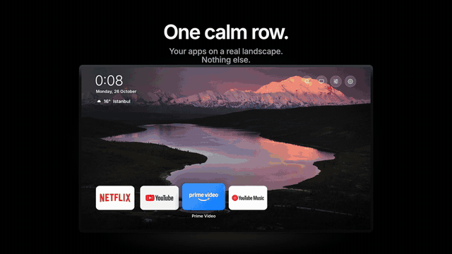
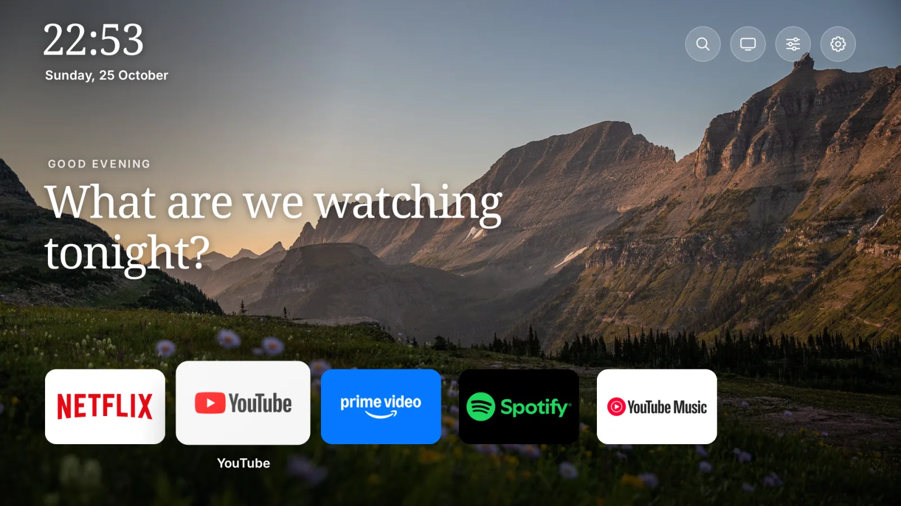
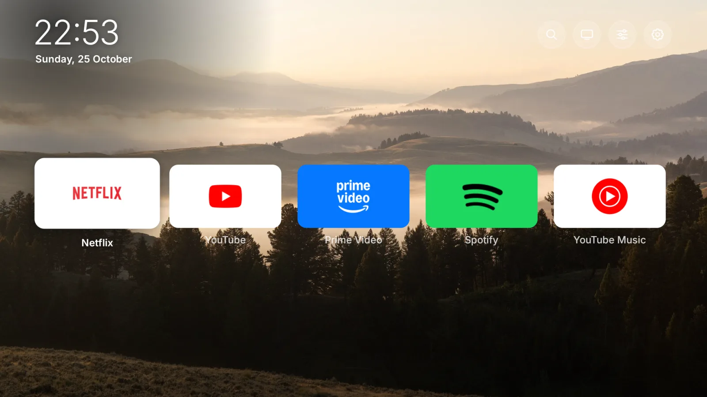
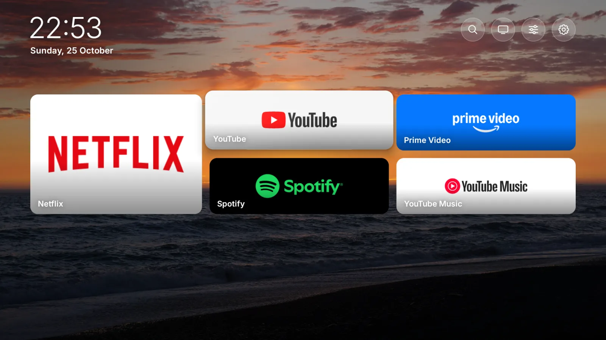
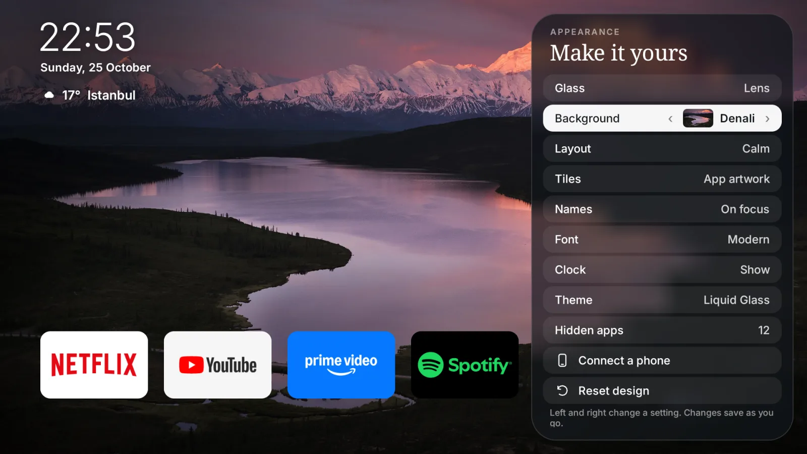
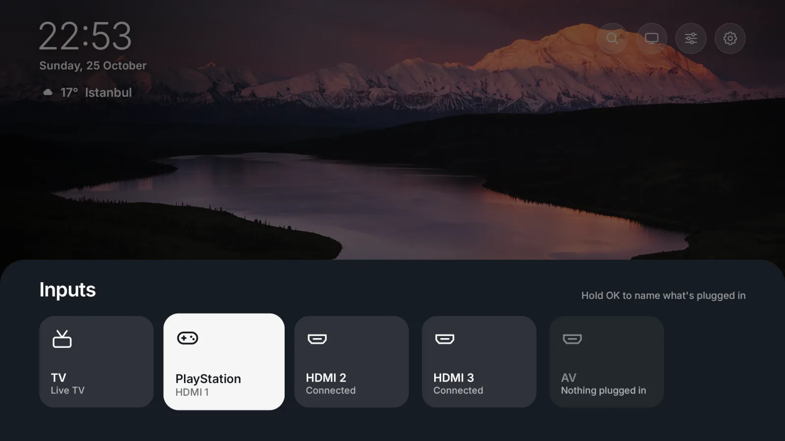
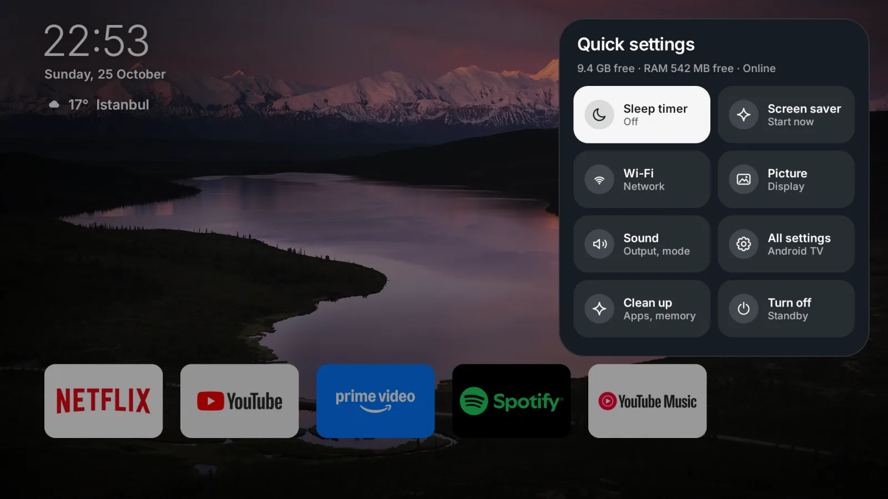

<div align="center">


# Pip: TV launcher and phone remote

**A calm, Apple TV–style home screen for Android TV and Google TV, with a remote on your phone.**

[Website](https://piptv.github.io/os/) · [Download for TV](https://github.com/PipTV/os/releases/latest/download/pip-tv.apk) · [Phone remote (Android)](https://github.com/PipTV/os/releases/latest/download/pip-remote.apk) · [Privacy](https://piptv.github.io/os/privacy.html)



[▶ Watch the film (35 s)](https://piptv.github.io/os/media/film.mp4) · [vertical](https://piptv.github.io/os/media/film-vertical.mp4)

</div>

> **Beta.** Version 0.9 runs every day on our own TV (a 2 GB Google TV). Expect rough edges and tell us about them in [Issues](https://github.com/PipTV/os/issues).

## What it does

- **A quiet home.** Real landscape photos, one row of apps, a clock. No ads, no rows of recommendations.
- **Five layouts.** Calm, Spotlight, App icons, Mosaic and Widgets. Switch them from the TV (Menu) or the phone.
- **Make it yours.** Background, tiles (app artwork, brand colors, frosted, logos only), names, a serif font, the clock, reset.
- **Inputs.** TV and every HDMI port as cards. Name what's plugged in (PlayStation, Xbox, Switch, PC).
- **Quick settings.** Sleep timer, screen saver, Wi‑Fi, picture, sound, turn off, free storage and memory.
- **Clean up.** Tick apps you don't use and hide or uninstall them together. Apps that came with the TV are never uninstalled.
- **Phone remote.** A touch surface, keyboard and volume, plus a live preview of the TV. Pair once with a 4-digit code.
- **Send to TV.** Share a YouTube or Netflix link on your phone and it opens in that app on the TV.
- **Fast on cheap TVs.** Focus moves at 60 fps in four of the five layouts, measured on a Mali-G52 TV with 1.8 GB of RAM.

| Spotlight | App icons | Mosaic |
|---|---|---|
|  |  |  |
| **Make it yours** | **Inputs** | **Quick settings** |
|  |  |  |

## Install on your TV (three steps, all with the remote)

1. On your TV, open **Google Play** and install **Downloader** (free, by AFTVnews).
2. Open Downloader, type **`piptv.github.io`** and press Go.
3. Press OK on **Install Pip**, then **Install**. If the TV asks, allow Downloader to install apps.

Then open **Pip OS** from your apps.

**With a computer (adb)**
```bash
adb connect YOUR_TV_IP:5555
adb install pip-tv.apk
```

**Phone remote.** No install needed: Pip shows a QR code (Menu → Connect a phone) that opens the remote in your phone's browser. You can also use the Android app, [pip-remote.apk](https://github.com/PipTV/os/releases/latest/download/pip-remote.apk). The iPhone app is coming.

**Optional: let the phone control every app.** To make the phone remote work inside Netflix, YouTube and other apps, turn on *Network debugging* in the TV's developer options. The TV then asks once to allow Pip; tick *Always allow*. Without it, the phone controls Pip's own screens only.

## Undo everything

Pip doesn't change your TV's system. To stop using it, uninstall **Pip OS** from *Settings → Apps*. Hidden apps are only hidden inside Pip. Nothing else was removed.

## Privacy

There are no accounts, no ads and no tracking. Weather uses your city name with [Open-Meteo](https://open-meteo.com). The phone talks to the TV only on your home network. Full text: [privacy](https://piptv.github.io/os/privacy.html).

## Credits

The built-in wallpapers are public-domain photographs from the US National Park Service, Bureau of Land Management and Fish and Wildlife Service ([list and sources](https://piptv.github.io/os/credits.html)). The type is Inter (SIL Open Font License).

---

This repository holds the releases and the website. The app's source code is private for now.
